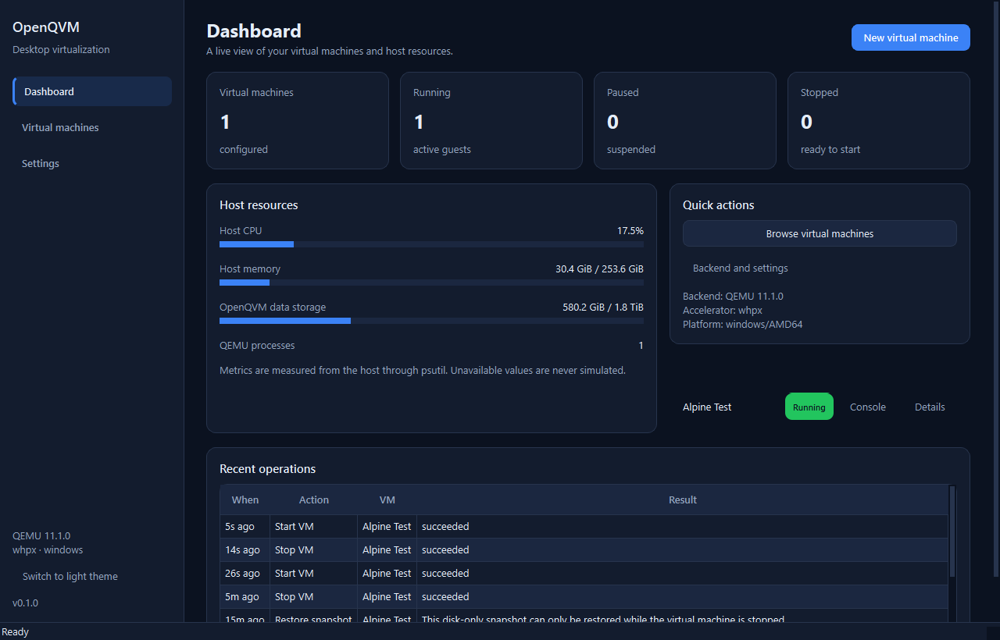
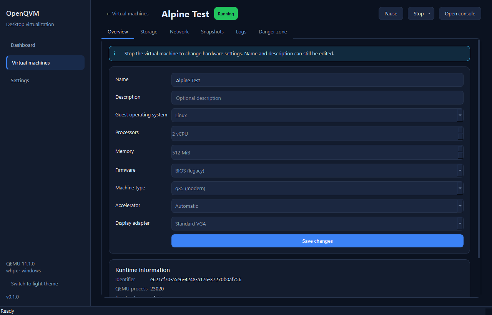
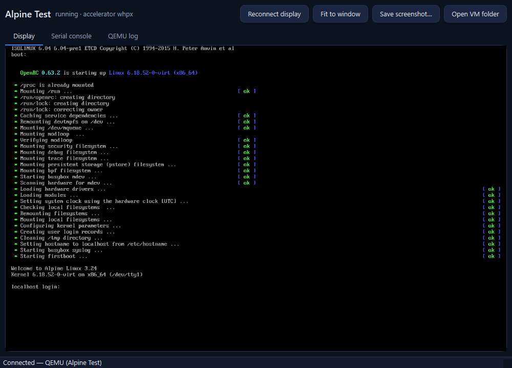
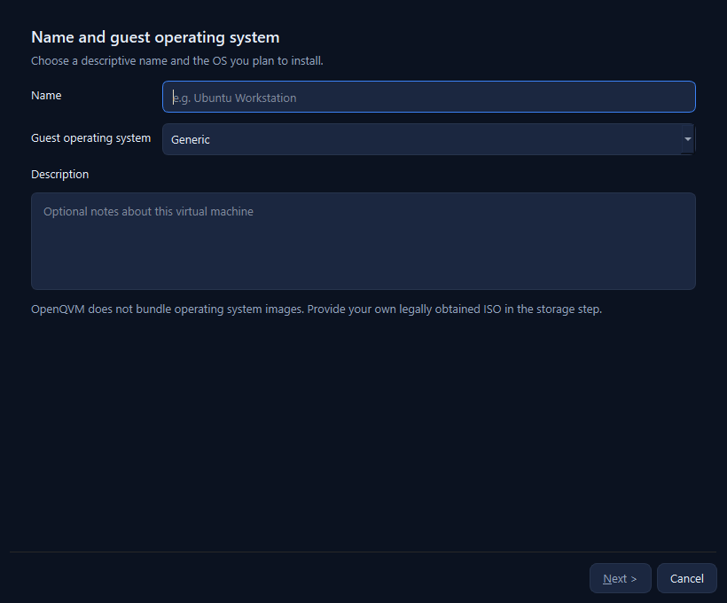
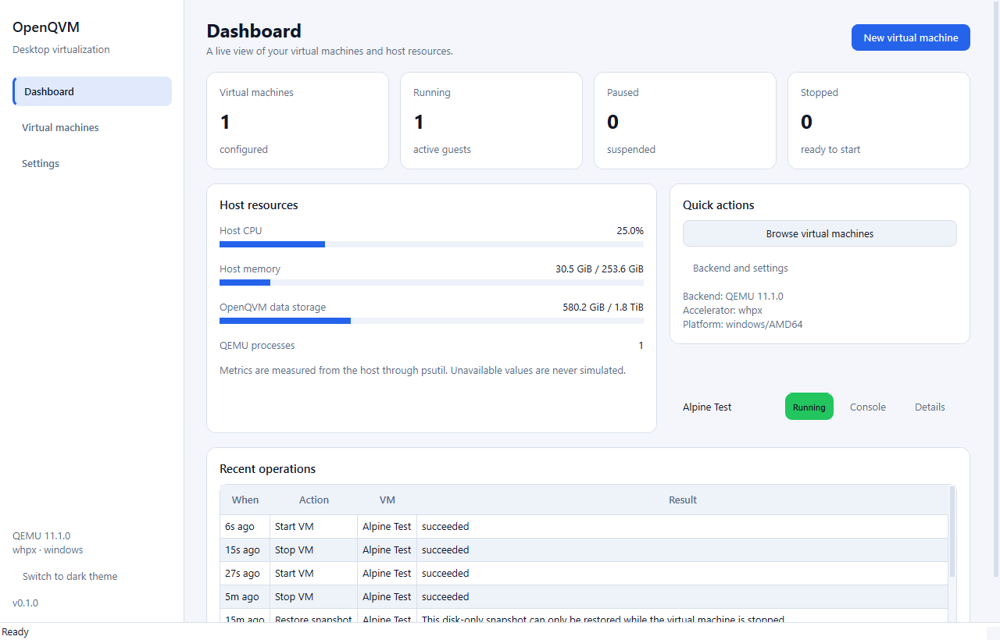

# OpenQVM

**OpenQVM** is an open-source desktop virtualization platform for Windows, Linux and macOS. It provides a polished Qt 6 interface for creating and running virtual machines with QEMU, with persistent configuration, a real graphics console, snapshots, cloning and portable VM packages.

> **Project status: 0.1.0 alpha.** This is a working implementation, not a mockup. A real Alpine Linux guest has been booted, controlled and captured through the OpenQVM backend, and the end-to-end test in this repository reproduces that run.



## Features that actually work

| Area | Status |
| --- | --- |
| Create, edit, start, stop, pause and resume VMs | ✅ Implemented through QEMU/QMP |
| Persistent VM configuration | ✅ Atomic JSON store with backup recovery |
| Real guest display in the app | ✅ Embedded VNC client (RFB, loopback) |
| Serial console and QEMU log | ✅ Streamed into the console window |
| Virtual disks (qcow2/raw, VirtIO/IDE) | ✅ Create, add, detach and grow |
| Installation ISO attach/eject | ✅ While the VM is stopped |
| Snapshots | ✅ Offline disk snapshots; online snapshots use memory state when the accelerator supports it, otherwise a disk-only fallback |
| Clone | ✅ Stopped VMs, independent disk copies |
| Export/import (`.oqv`) | ✅ ZIP package with SHA-256 integrity checks |
| NAT networking with port forwarding | ✅ |
| Bridged / host-only networking | ❌ Not implemented (detected and reported, never silently faked) |
| Shared folders | ✅ Linux hosts (virtio-9p); unavailable on Windows/macOS |
| UEFI firmware | ✅ When edk2/OVMF is installed |
| TPM 2.0 | ❌ Not implemented yet; Windows 11 guests warn about this |
| Real host/VM metrics | ✅ Measured with psutil; unavailable values are labelled |
| Dark and light themes | ✅ |

## Screenshots

| VM details | Embedded guest console |
| --- | --- |
|  |  |

| Creation wizard | Light theme |
| --- | --- |
|  |  |

## Architecture in one paragraph

OpenQVM is a Python 3.11+ application. The Qt 6 GUI talks to an in-process `VmManager`, which owns a persistent JSON store and delegates to a QEMU backend. The backend launches `qemu-system-x86_64` as a detached process, controls it over QMP on a random loopback port, and exposes the guest framebuffer through QEMU's loopback-only VNC server. Platform adapters detect KVM, WHPX, HVF or TCG and report optional features (UEFI, bridged networking, shared folders, TPM) truthfully. See [docs/architecture.md](docs/architecture.md).

```
Qt 6 GUI / CLI
      │
      ▼
VmManager ──► JSON store (atomic writes, per-VM locks)
      │
      ├──► QEMU backend ──► qemu-system-x86_64 (detached)
      │         │                 ├── QMP (127.0.0.1, random port)
      │         │                 ├── VNC (127.0.0.1)
      │         │                 └── serial log file
      │         └──► qemu-img (disks, snapshots, clones, exports)
      └──► QMP/RFB clients
```

## Requirements

- Python **3.11+** (tested with 3.13)
- **QEMU 8+** with `qemu-system-x86_64` and `qemu-img`
- PySide6 6.8+ and psutil (installed automatically)
- Linux: KVM is strongly recommended (`/dev/kvm` accessible to your user)
- Windows: WHPX (Windows Hypervisor Platform) is recommended; TCG works but is slower
- macOS: HVF when available

OpenQVM does **not** bundle operating-system images or QEMU. Obtain installation media legally from the operating system vendor.

## Install and run

### Windows

```powershell
winget install SoftwareFreedomConservancy.QEMU
py -3.13 -m venv .venv
.\.venv\Scripts\Activate.ps1
pip install -e ".[dev]"
openqvm            # desktop application
openqvm-cli doctor --probe
```

If WHPX is not enabled, run PowerShell as administrator and enable the *Windows Hypervisor Platform* optional feature, then reboot. `openqvm-cli doctor --probe` verifies the accelerator by starting QEMU briefly.

### Linux

```bash
sudo apt install qemu-system-x86 qemu-utils python3-venv
sudo usermod -aG kvm "$USER"   # log out and back in
python3 -m venv .venv
source .venv/bin/activate
pip install -e ".[dev]"
openqvm-cli doctor --probe
openqvm
```

### macOS

```bash
brew install qemu python@3.13
python3.13 -m venv .venv
source .venv/bin/activate
pip install -e ".[dev]"
openqvm-cli doctor --probe
openqvm
```

Detailed instructions, data-directory locations and troubleshooting are in [docs/installation.md](docs/installation.md).

## First virtual machine

1. Start `openqvm`.
2. Choose **New virtual machine** and select the guest OS.
3. Adjust CPU, memory, firmware and disk settings.
4. Attach your installation ISO.
5. Finish the wizard. OpenQVM creates a real qcow2 disk and registers the VM.
6. Select the VM and choose **Start**. The console window opens with the guest display.

The CLI mirrors the GUI:

```bash
openqvm-cli create --name "Ubuntu Workstation" --os ubuntu --cpus 2 --memory 2048 --disk 20 --iso /path/to/ubuntu.iso
openqvm-cli list
openqvm-cli start <vm-id>
openqvm-cli status <vm-id>
openqvm-cli snapshot create <vm-id> before-upgrade --description "Fresh install"
openqvm-cli stop <vm-id> --force
openqvm-cli export <vm-id> ./ubuntu.oqv
openqvm-cli import ./ubuntu.oqv
```

Use `openqvm-cli --help` and the subcommand help for all options. All operations are also available programmatically through `openqvm.vm.manager.VmManager`.

## Testing

```bash
pytest tests/unit tests/integration -q       # no QEMU required
pytest tests/end_to_end -m e2e -q -s         # real QEMU boot test
```

The end-to-end test needs QEMU and an Alpine ISO. It looks for `OPENQVM_TEST_ISO`, then for `alpine-virt-*.iso` in the OpenQVM ISO folder. It performs a real boot, verifies serial output, captures a VNC framebuffer, pauses/resumes, snapshots, restores, exports, imports and clones. Set `OPENQVM_TEST_ISO` explicitly in CI or on other systems.

The test suite includes 63 unit/integration tests plus the real-QEMU end-to-end test. GUI tests run with Qt's offscreen platform.

## Security

OpenQVM uses argv-based process execution (no shell), validates all user and package input, confines disk paths to the VM directory, and keeps QMP and VNC on the loopback interface. Read [docs/security.md](docs/security.md) for the trust model and known limitations. Report vulnerabilities according to [SECURITY.md](SECURITY.md).

Known security-related limitations in this alpha:

- QMP and VNC are loopback-only but not authenticated. Another local user on a multi-user host could connect to a running VM's console or control socket.
- Disk images are not encrypted by OpenQVM.
- Deleting a VM moves its folder to the trash; secure erase is not guaranteed, especially on SSDs.

## Known limitations

- **Validated host:** the implementation was built and validated on Windows 11/AMD64 with QEMU 11.1, WHPX and TCG, including a real Alpine Linux boot. The Linux/KVM path is the intended primary deployment target but was not executed in this development environment; macOS is untested. The QEMU backend, command builder and platform adapters are shared across all three.
- Bridged and host-only networking are not implemented. The UI explains why instead of pretending they work.
- Shared folders use virtio-9p and are only enabled on Linux hosts.
- Live ISO changes, live disk resize, clipboard integration and USB passthrough are not implemented.
- Long-running operations have timeouts and force-stop recovery, but they cannot be cancelled midway from the UI yet.
- Online snapshots include guest memory only when QEMU can save it (KVM/TCG typically can; WHPX cannot). The fallback is an explicitly labelled disk-only snapshot that must be restored while the VM is stopped.
- Cloning does not copy snapshot history. Use export/import if you need a disk with its internal snapshots.
- Installers, code signing and package repositories are not provided yet.

## Repository layout

```
src/openqvm/
  core/          domain models, validation, persistence helpers, logging
  platform/      capability detection, QEMU discovery, Linux/Windows/macOS adapters
  vm/            manager, backend interface, QEMU process/QMP/RFB clients
  storage/       disks, ISO inspection, export/import
  snapshots/     qcow2 and QMP snapshot support
  networking/    NAT/bridged argument construction and security notes
  services/      operation history and host metrics
  app/           composition root
  ui/            Qt 6 application, pages, console and VNC widget
tests/           unit, integration, end-to-end
docs/            architecture, installation, development, security
```

## Contributing

Contributions are welcome. Read [CONTRIBUTING.md](CONTRIBUTING.md) before opening a pull request. The roadmap distinguishes implemented and planned work in [ROADMAP.md](ROADMAP.md).

## License

OpenQVM is licensed under the **Apache License 2.0**. See [LICENSE](LICENSE). QEMU, PySide6/Qt, psutil and other dependencies keep their own licenses; see [THIRD_PARTY_NOTICES.md](THIRD_PARTY_NOTICES.md).
