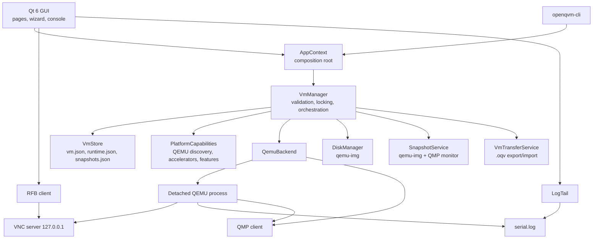
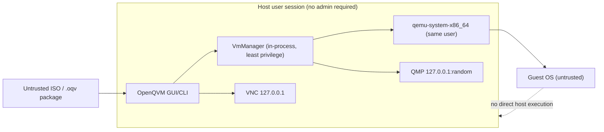

# OpenQVM architecture

## 1. Scope and goals

OpenQVM is a desktop virtualization manager. It integrates an existing hypervisor
(QEMU) instead of implementing one. It must:

- manage VM configuration and lifecycle reliably;
- never report success when QEMU failed;
- keep privileged operations out of the GUI;
- treat ISO images and imported VM packages as untrusted input;
- report platform capabilities honestly, including unavailable metrics and features.

Non-goals for 0.1.0: a custom hypervisor, a hosted multi-tenant control plane, or
paravirtualized drivers supplied by OpenQVM.

## 2. Chosen stack and initial target

| Layer | Choice | Reason |
| --- | --- | --- |
| GUI | Python 3.11+ / PySide6 6.8+ (Qt 6) | Reliable native widgets, accessibility, cross-platform |
| Backend | QEMU (`qemu-system-x86_64`) | Mature, cross-platform, supports KVM/WHPX/HVF/TCG |
| Disk tooling | `qemu-img` | qcow2 snapshots, conversion and inspection |
| Control protocol | QMP + a small RFB client | Stable process control and real guest framebuffer |
| Persistence | Versioned JSON + atomic replace | Simple, inspectable, crash-safe |
| Tests | pytest, headless Qt, real-QEMU e2e | Verify behavior, not mock success |

The user-facing target is Linux/KVM first, then Windows/WHPX and macOS/HVF. This
repository's integration test was executed on **Windows 11/AMD64 with QEMU 11.1,
WHPX and TCG**, because that was the available development host. The KVM and HVF
code paths share the same backend; they are detected and reported but were not
executed in this environment. No hardware-accelerated Linux or macOS validation
is claimed.

## 3. Components



### 3.1 Core

`openqvm.core` contains enums and dataclasses for VM definitions, runtimes and
snapshots, validation rules, path confinement, atomic writes, file locking,
logging redaction and structured errors. The model rejects unknown fields and
future schema versions instead of silently discarding data.

### 3.2 Persistence

Each VM owns a directory:

```
<data>/vms/<uuid>/
  vm.json           versioned VMSpec, atomically replaced, .bak recovery
  runtime.json      status, PID and process creation time, QMP/VNC ports
  snapshots.json    snapshot metadata (description, memory inclusion)
  disks/            qcow2/raw images (and deleted/ quarantine for detached disks)
  firmware/         per-VM OVMF variable store
  qemu.log          stdout/stderr from QEMU
  serial.log        guest serial console
  qemu.pid          QEMU pid file
.locks/<uuid>.lock  advisory lock outside the VM directory
```

Writes use a temporary file, `fsync` and `os.replace`. The previous `vm.json` is
kept as `vm.json.bak`; a corrupt primary file is recovered from the backup.

### 3.3 Validation and compatibility

Structural validation (names, CPU/RAM/disk bounds, MAC addresses, port forwarding,
boot order, paths, shared folders) is separate from platform validation (UEFI
firmware availability, bridged/host-only support, shared folders, accelerator).
Both run before a VM is created, started or modified. Starting performs the
platform checks again so a configuration imported from another host cannot bypass
them.

### 3.4 Backend

`QemuBackend` owns the QEMU process lifecycle:

- **Start:** allocate loopback ports, prepare the UEFI variable store, build argv,
  launch QEMU detached (so VMs survive closing the GUI), wait for QMP, persist
  runtime state. If QMP never becomes ready, QEMU is terminated and the actual
  log tail is returned.
- **Stop:** ACPI `system_powerdown` with a timeout; the user can explicitly force
  `quit`/terminate. Graceful stop never silently escalates.
- **Pause/resume:** QMP `stop`/`cont`.
- **Refresh:** verify PID **and** process creation time, then query QMP status.
  A recycled PID is never signalled.
- **Delete:** only stopped VMs; the directory is moved to the trash.

The command builder uses an argv list only (`shell=False`), rejects control
characters, escapes commas in QEMU option values, and never passes untrusted
strings to a shell.

### 3.5 Console

QEMU exposes VNC on `127.0.0.1`. OpenQVM's RFB 3.8 client implements the `None`
security type and Raw encoding, converts QEMU's BGRX framebuffer to RGB, and
forwards keyboard/pointer events. Serial output is streamed from `serial.log`.
The client is intentionally small and is covered by a fake-server unit test and
by the real-QEMU e2e test, which captures a real framebuffer and proves keyboard
input by logging in and running a command.

The VM is launched with an absolute USB tablet (`qemu-xhci` on q35, `-usb` on the
legacy pc machine) so VNC pointer coordinates map directly instead of drifting as
with a relative PS/2 mouse. The console also offers Ctrl+Alt+Del (which Windows
reserves on the host) and "type text", which sends ordinary key events using a US
keyboard mapping and therefore works without a guest agent. The RTC uses
`base=localtime` for Windows guests and `base=utc` for everything else.

### 3.6 Storage and snapshots

- Disks are created and inspected with `qemu-img`; formats and virtual sizes are
  verified after creation.
- Resizing only grows a disk. Shrinking is refused because it can corrupt the
  guest file system.
- Offline resizing uses `qemu-img resize`. While the VM is running, OpenQVM uses
  QEMU's `block_resize` on the drive's block backend and verifies the size QEMU
  reports. The guest must rescan the block device to observe the change.
- A CD-ROM drive is always present. Attaching, replacing or ejecting media on a
  running VM uses `blockdev-change-medium` / tray commands over QMP. QEMU's media
  lock is respected: while the guest is using the medium the operation fails with
  an explanation, and `force` is an explicit, documented override.
- Offline snapshots use `qemu-img snapshot` and are **disk-only**.
- Online snapshots first attempt QEMU's `savevm`, which includes RAM when the
  accelerator supports it. If the accelerator cannot save memory (WHPX reports
  missing dirty memory tracking), OpenQVM falls back to per-disk
  `blockdev-snapshot-internal-sync` and records the snapshot as disk-only.
- Disk-only snapshots cannot be restored online; OpenQVM refuses instead of
  invoking `loadvm` and leaving QEMU in an unusable state.
- Export packages are ZIP files with a manifest and SHA-256 checksums. Import
  rejects traversal, duplicate entries, unexpected names, symlinks, oversized
  members, unsafe compression ratios and checksum mismatches before registering
  anything.
- Clone requires a stopped VM and uses `qemu-img convert`; snapshot history is
  not copied.
- Backups reuse the export writer: `BackupPolicy` decides when a stopped VM is
  due, `VmManager.backup_vm` writes a timestamped package and rewrites
  `backups.json`, and the retention window deletes the oldest packages. The
  scheduler lives in the GUI (a timer plus one check after startup) and in
  `openqvm-cli backup --due`; both call the same manager method, which publishes
  `backups.changed` so open pages refresh without polling.

### 3.7 Networking

NAT uses QEMU user-mode networking with explicit host-forward rules. Bridged mode
requires a host bridge and `qemu-bridge-helper` on Linux; it is reported as
unavailable where OpenQVM cannot configure it. Host-only networking is not
implemented. The UI explains the security implications of each mode.

## 4. Concurrency and failure handling

- Every mutation holds a per-VM advisory file lock (`msvcrt` on Windows,
  `flock` on POSIX). The lock file lives outside the VM directory so the
  directory can be quarantined while locked.
- GUI operations run on a Qt thread pool; the interface remains responsive.
- ``VmManager`` publishes typed events (``openqvm.core.events``) for create,
  update, delete, lifecycle transitions, snapshot changes and finished operations.
  The GUI subscribes and refreshes immediately; the periodic poll remains only as
  a fallback for state changed by another process.
- Runtime state is persisted before/after every transition.
- A VM with a live QEMU process but an unreachable QMP socket is marked
  `unknown`; destructive disk operations are refused until the process is
  stopped.
- Long operations (boot, export, disk creation) surface progress or a busy
  indicator, and errors include a code, hint and log excerpt. `operation.started`
  and `operation.progress` events carry the action, an optional 0-1 fraction and a
  human-readable phase; the GUI shows a determinate bar when a fraction is known
  and the CLI renders the same events on stderr.
- Long-running work accepts a ``CancellationToken`` (``openqvm.core.cancellation``).
  The GUI's ``AsyncRunner`` creates one token per job and exposes the Cancel
  button in the status bar; ``run_tool`` polls its child process every 200 ms and
  terminates it on cancellation, ``DiskManager.copy`` checks between 4 MiB chunks,
  and export/import remove their temporary archive or staging directory before the
  ``CancelledError`` reaches the caller. Each layer therefore cleans up its own
  partial state instead of relying on the top-level caller.

## 5. Trust boundaries



- There is no privileged daemon or root service in this release. If one is added,
  it must authenticate the GUI and use a narrow, validated RPC surface.
- The guest runs in QEMU, never in the host Python process.
- QMP/VNC are loopback-only but unauthenticated; see
  [security.md](security.md) for the resulting local-user threat and planned
  mitigations.
- Imported VM configurations and ISOs are data, not code. They are never
  executed on the host.

## 6. Extending

To add a backend, implement the `VirtualizationBackend` protocol
(`start`, `stop`, `pause`, `resume`, `refresh`, `qmp_client`) and expose honest
`BackendCapabilities`. Storage and transfer remain backend-independent as long as
the disk format is supported by the backend. For macOS Virtualization.framework
or Hyper-V/WHPX-specific integrations, keep platform code behind
`openqvm.platform` and preserve the validation and error contracts.
