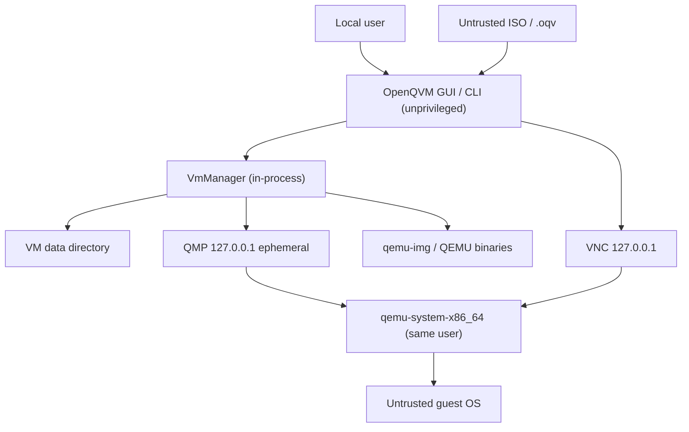

# Security model

## Threat model

OpenQVM is a single-user desktop application. It assumes the local user account is
trusted and the host operating system is patched. It protects against:

- malformed or malicious VM configurations and imported `.oqv` packages;
- path traversal and unexpected files during import;
- command injection through names, paths, network options or ISO metadata;
- accidental command execution with a shell;
- confusing a recycled PID with a running QEMU process;
- operations on live disks that could corrupt data;
- leaking secrets into logs.

It does **not** attempt to protect against:

- a compromised guest escaping QEMU (that is QEMU's security boundary; keep QEMU
  current and use hardware acceleration with up-to-date firmware);
- a malicious local administrator or kernel compromise;
- other local users connecting to loopback QMP/VNC ports (see limitations);
- data remanence or forensic recovery after deletion;
- malicious firmware or operating-system installation media.

## Trust boundaries

There is no privileged service in this release. Future privileged helpers must
authenticate the GUI, validate every field and expose a minimal RPC surface.

## Controls implemented

### Process execution

- All commands use `subprocess` with an argv list; `shell=True` is never used.
- QEMU option values reject control characters and escape commas.
- QEMU is started with `-no-user-config`, so per-user QEMU configuration cannot
  inject options.
- The environment passed to QEMU is restricted to a small allow-list.
- Process identity is verified using both PID and creation time before a signal is
  sent; a recycled PID is never terminated.

### Input and path validation

- Names, descriptions, CPU/RAM/disk bounds, MAC addresses, port forwards, bridge
  names, shared folder tags and snapshot names are validated before use.
- Disk file names are single path components and resolved inside the VM directory
  with traversal checks; disk symlinks are rejected before launch.
- ISO paths must be absolute, normalized, existing files with an accepted
  extension; the ISO-9660 descriptor is inspected (a warning is shown for
  non-ISO9660 images).
- Unknown fields and future configuration schema versions are rejected rather
  than silently ignored.

### Package import

`VmTransferService.import_vm` treats the ZIP as hostile:

- only `manifest.json`, `disks/<plain-name>` and `firmware/OVMF_VARS.fd` are
  allowed; duplicate entries, absolute paths, backslashes, traversal and symlinks
  are rejected;
- manifest format and version are checked;
- each member is size-limited and the total uncompressed size and compression
  ratio are capped;
- SHA-256 checksums are verified with a constant-time comparison before files are
  registered;
- disk format and virtual size are verified with `qemu-img` after extraction;
- the VM is written to a staging directory and atomically renamed; failures remove
  the staging directory and never register a partial VM;
- identifiers, names and MAC addresses are regenerated to avoid collisions.

### Privilege

- The application does not request elevation and runs with the user's privileges.
- Bridged networking (when available on Linux) requires host configuration and
  `qemu-bridge-helper`; OpenQVM does not modify network configuration or install
  helpers.
- No guest operating-system code is executed in the host process.

### Control channels

- QMP binds to `127.0.0.1` on an ephemeral port and is closed after each
  operation.
- VNC binds to `127.0.0.1` and is used only by the embedded console.
- Both are unauthenticated in this release. They are not exposed on external
  interfaces. Record this limitation when operating on a multi-user host.

### Data integrity

- Configuration, runtime and snapshot metadata are written with a temporary file,
  `fsync` and atomic replace; the previous `vm.json` is kept as a backup.
- Per-VM advisory locks serialize operations across processes.
- Disk resize only grows; shrink is refused.
- Destructive operations require explicit confirmation in the UI/CLI.
- Deleted VMs are quarantined in a trash directory; snapshot and disk deletions
  inside a VM are permanent.

### Logging

- Logs include operation names, exit codes and error details.
- A redaction filter removes values that look like `password=`, `token=`,
  `secret=` and similar. QMP/VNC passwords are not used in this release.

## Known limitations and planned mitigations

| Risk | Current state | Planned mitigation |
| --- | --- | --- |
| Local user connects to QMP/VNC | Loopback-only, no authentication; VNC has no password | Random per-session token over Unix sockets / authenticated local proxy |
| Disk images unencrypted | qcow2/raw plain files | Optional qcow2 encryption or OS-level encryption guidance |
| Secure deletion | Trash + unlink; SSD remanence possible | Documented limitation; optional cryptographic erasure |
| Guest escape | Relies on QEMU hardening and host updates | Keep QEMU current; recommend KVM/WHPX; no host filesystem sharing by default |
| TPM/Windows 11 | Not implemented | Integrate swtpm or platform TPM APIs |
| Bridged network exposure | Not implemented; UI explains the risk | Privileged helper with explicit authorization |
| Dependency vulnerabilities | No automated audit in CI yet | Add pip-audit and dependency review |
| No signed builds | Source installs only | Reproducible builds and code signing |

## Reporting a vulnerability

Do not open a public issue. Follow [SECURITY.md](../SECURITY.md). Include the
affected version, host platform, steps to reproduce and the smallest relevant log
excerpt with secrets removed.

## Hardening recommendations for users

- Keep QEMU, Python, PySide6 and the host OS updated.
- Use hardware acceleration and keep host firmware/CPU microcode current.
- Do not run untrusted workloads on a multi-user host while QMP/VNC authentication
  is unavailable.
- Verify ISO checksums and package checksums before use.
- Back up VMs by exporting them while stopped.
- Store VM data on encrypted storage if the data is sensitive.
